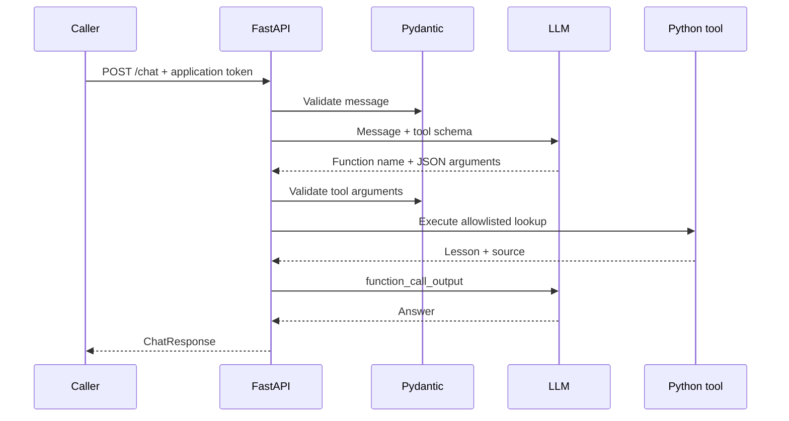

# FastAPI + LLM Agent

A practical Python tutorial connecting **type hints → Pydantic → FastAPI → an LLM tool-calling loop**. Build a programming tutor that retrieves short, approved lessons through a validated Python function.

This is a learning starter, not a deployed SaaS. The application uses real OpenAI calls when configured. Automated tests use explicitly labeled test doubles and never contact a provider.

## Start here

- [Worked case-study notebook](fastapi-llm-agent-case-study.ipynb): explanations, executable examples and recorded outputs; no credentials needed.
- [HTTP application](app/main.py): endpoints, validation, authentication and error handling.
- [Agent and tool](app/agent.py): the model requests a tool; Python decides what can execute.
- [Tests](tests): success and failure behavior, without billable API requests.

## Quick start

Use Python 3.12+. From this repository:

```bash
python -m venv .venv
# Windows PowerShell: .venv\Scripts\Activate.ps1
# macOS/Linux: source .venv/bin/activate
python -m pip install -r requirements.txt
python -m pytest -q
```

Copy `.env.example` to `.env` (PowerShell: `Copy-Item .env.example .env`; macOS/Linux: `cp .env.example .env`). Fill it in locally:

| Variable | Purpose |
|---|---|
| `OPENAI_API_KEY` | Your server-side OpenAI credential |
| `OPENAI_MODEL` | A Responses API model with function calling available to your account |
| `APP_API_TOKEN` | A separate secret protecting this application's `/chat` endpoint |

Generate an application token with `python -c "import secrets; print(secrets.token_urlsafe(32))"`. Never use your OpenAI key as the application token.

```bash
python -m uvicorn app.main:app --reload --env-file .env
```

Open `http://127.0.0.1:8000/docs`. Click **Authorize**, enter `APP_API_TOKEN`, then try `POST /chat`:

```json
{"message": "How do Pydantic type hints help FastAPI validate requests?"}
```

An answer is generated at request time; it is not a fixed demo response. `tools_used` reports successfully executed tools. Missing configuration returns 503, rather than pretending that an AI answered. `/health` checks the HTTP process only, not provider readiness.

## How the pieces fit



### 1. Type hints describe the contract

`message: str` describes a string; `list[str]` describes a list of strings; `-> ChatResponse` describes a return value. Python alone does not enforce these annotations. Pydantic checks model fields at runtime, and FastAPI uses those models to validate request bodies and document the API.

### 2. An endpoint receives the request

`@app.post('/chat')` connects an HTTP route to an async Python function. The Pydantic request model rejects empty, oversized, wrongly typed and unexpected fields. `Depends` runs authentication and a request limiter before agent execution. `await` lets the server yield while it waits for provider I/O; it does not make CPU-heavy code parallel.

### 3. The model proposes a tool call

The agent provides a JSON schema for `lookup_lesson`. The model can request a supported topic, but it cannot directly invoke Python. The application checks the name against its allowlist and validates arguments again before reading the lesson dictionary. No `eval`, shell, arbitrary URL access, booking or messaging capability is exposed.

### 4. The application returns the result

The loop preserves provider output items and appends a `function_call_output` with the matching `call_id`. The model then explains the returned lesson. It is limited to four provider requests, with output limits, per-call timeout and a 45-second overall deadline. Tool errors return bounded messages; provider details are not exposed to callers.

## Run with Docker

```bash
docker build -t fastapi-llm-agent .
docker run --rm --env-file .env -p 127.0.0.1:8000:8000 fastapi-llm-agent
```

The image excludes `.env`, runs as a non-root user and uses one worker. Docker configuration is supplied; the image has not been exercised against a live provider.

## Scope and next steps

Each request is independent: no persistent conversation memory or database. The ten-requests-per-minute limiter is global to one process, resets on restart, and is not a billing cap. Two requests may execute concurrently. Public deployment needs HTTPS, a request-body size limit at the proxy, shared rate limits, per-user authentication, usage budgets and monitoring. Do not embed the shared application token in a public widget.

`store=False` disables Responses application-state storage; it is not a claim of zero provider retention. Model-generated text can still be inaccurate despite instructions. Add grounded-answer evaluations before using this pattern for consequential business advice. The tool has no side effects and cannot create fake bookings.

To extend this example, add one read-only tool with a Pydantic argument model, a fixed dispatch entry, and tests for invalid arguments. Keep database authorization outside model-generated parameters.

## Official references

- [FastAPI request bodies](https://fastapi.tiangolo.com/tutorial/body/)
- [Pydantic models](https://docs.pydantic.dev/latest/concepts/models/)
- [OpenAI function calling](https://developers.openai.com/api/docs/guides/function-calling)

No API credentials are included. Tests and notebook examples run offline; a live `/chat` request requires your configuration and incurs provider usage.
